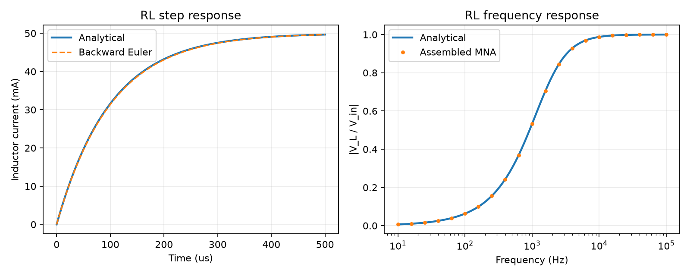

# Python Circuit Simulator

A modular Python implementation of a SPICE-like circuit simulator based on Modified Nodal Analysis (MNA).

## Week 3 interface update

The existing implementation now uses a shared component interface:
`nodes`, `requires_branch_current`, and
`stamp(node_map) -> (g_entries, m_entries, rhs_entries)`.
G/M entries are `(row, column, value)` triples; RHS entries are `(row, value)`
pairs. Empty contributions use `[]`. Components omit ground entries.

`assemble()` still returns `(G, b)` for the existing DC demo.
`assemble_system()` returns `(G, M, b)` for `G*x + M*dx/dt = b`.
Branches are allocated before stamping and resolved with
`node_map.get_branch_index(name)`. The assembler no longer checks device types.

Week 3 adds `Inductor` and the four controlled sources `VCVS`, `VCCS`, `CCCS`,
and `CCVS` through this existing interface. Their implementations contain
step-by-step comments explaining KCL signs, voltage constraints, and control
branch references. The original assembler and `main.py` do not need changes.

## Current Scope

The current implementation supports:

- Node mapping
- Resistor modeling
- Independent voltage source modeling
- Ideal inductor modeling
- Voltage- and current-controlled voltage/current sources (VCVS/VCCS/CCCS/CCVS)
- MNA matrix assembly
- Sparse matrix construction using COO and CSC formats
- DC circuit solving
- Analytical benchmark validation
- Reusable circuit parameter testing
- RL DC, AC, and backward Euler transient examples using the Week 2 solvers
- Automated circuit-level tests and exported analytical validation results

`main.py` remains the original DC divider demo. `linear_examples.py` demonstrates
the new linear components and DC/AC/transient solver integration. Nonlinear
device models and netlist parsing are outside this linear-component task.

## Project Structure

```text
circuit_simulator/
├── README.md
├── main.py
├── node_map.py
├── resistor.py
├── voltage_source.py
├── inductor.py
├── controlled_sources.py
├── linear_solvers.py
├── linear_examples.py
├── results/
└── mna_assembler.py
```

| File | Responsibility |
|---|---|
| `main.py` | Builds the example circuit, runs DC analysis, prints the solution, and checks the output voltage |
| `node_map.py` | Maps non-ground node names to matrix indices; ground has no voltage unknown |
| `resistor.py` | Defines a resistor and returns its conductance-matrix contributions |
| `voltage_source.py` | Defines an ideal voltage source and returns matrix entries and its voltage constraint |
| `inductor.py` | Adds an inductor current unknown and the law V(+) - V(-) - L*dI/dt = 0 |
| `controlled_sources.py` | Defines four constant-gain linear controlled-source classes |
| `linear_solvers.py` | Reuses the Week 2 DC, AC, and backward Euler sparse solvers unchanged |
| `linear_examples.py` | Builds new-device circuits, verifies analytical results, and exports evidence |
| `mna_assembler.py` | Registers elements, assigns branch-current indices, and assembles the sparse MNA system |

## Architecture and Program Flow

The program follows this sequence:

1. `main.py` creates the circuit elements and registers them with the assembler.
2. `NodeMap` assigns indices to non-ground nodes. Ground is the reference node at 0 V and is not included in the unknown vector.
3. Each independent/controlled voltage source and each inductor receives an additional unknown for its branch current.
4. Each element's `stamp()` method returns the matrix entries contributed by that element.
5. `MNAAssembler` combines the contributions into a sparse matrix and a right-hand-side vector.
6. The example converts the small matrix to a dense array, solves the linear system, and compares the result with an analytical calculation.

```text
Circuit elements
      |
      v
  NodeMap ----------------> Node indices
      |
      v
Element stamping
      |
      v
 MNAAssembler ------------> Sparse matrix A and RHS b
      |
      v
 Solve A x = b
      |
      v
Node voltages and source currents
      |
      v
Analytical validation
```

## MNA Formulation

The general assembled system is `G*x + M*dx/dt = b`. For DC, derivatives are
zero and the matrix `A` below is `G`, so the original benchmark has the form:

```text
A x = b
```

For the benchmark, the unknown vector is:

```text
x = [Vin, Vout, I_Vs]^T
```

It contains non-ground node voltages first, followed by currents through the
voltage-defined devices. With new components, these include inductors, VCVS,
and CCVS as well as independent voltage sources.

The same matrices support three analyses:

- DC: `G*x = b`.
- AC: `(G + j*2*pi*f*M)*x = b_ac`, using `exp(+j*omega*t)`.
- Backward Euler: `(G + M/dt)*x[n] = b(t[n]) + (M/dt)*x[n-1]`.

### Resistor contribution

For a resistor with resistance `R`, its conductance is `g = 1/R`. The resistor contributes:

- `+g` to the diagonal entry for each non-ground terminal
- `-g` to the off-diagonal entries when both terminals are non-ground
- No matrix entry for ground, because ground has no unknown index

### Ideal voltage-source contribution

An ideal voltage source imposes the constraint:

```text
V(+) - V(-) = source_voltage
```

Because the source current cannot be represented by a conductance alone, MNA adds a separate current unknown. The current appears in the connected nodes' KCL equations, and the voltage constraint adds a row and column to the matrix.

## Additional Linear Components

### Inductor

```python
from inductor import Inductor

L1 = Inductor("L1", "out", "GND", 10e-3)  # 10 mH
```

Current `I_L1` is positive from `node_plus` to `node_minus`. The physical law is:

```text
V(+) - V(-) = L*dI_L/dt
```

The branch equation is therefore `V(+) - V(-) - L*dI_L/dt = 0`.
Voltage and KCL terms enter `G`, and `M[k,k] = -L`. The negative matrix entry
comes from rearranging the equation; the inductance itself must be positive
and finite.

At DC the derivative is zero, so the inductor enforces zero terminal voltage
while retaining its branch current. At AC it gives `Z_L = j*omega*L`.
Transient initial current is supplied in the solver's `x0`, not stored as an
independent source in the component stamp.

### Controlled sources

Define `Vc = V(control_plus) - V(control_minus)`. Output current is positive
from `node_plus` to `node_minus`. Control current uses the reference direction
of the named control device.

| Class | Constitutive equation | Coefficient unit | New output-current unknown? |
|---|---|---|---|
| `VCVS` | `Vout = gain*Vc` | V/V | Yes |
| `VCCS` | `Iout = transconductance*Vc` | A/V (S) | No |
| `CCCS` | `Iout = gain*Ic` | A/A | No |
| `CCVS` | `Vout = transresistance*Ic` | V/A (ohm) | Yes |

All four are algebraic: only `G` receives entries, with empty `M` and RHS
contributions. Coefficients may be positive, negative, or zero, but must be
finite. Voltage-control inputs draw no current.

```python
from controlled_sources import VCVS, VCCS, CCCS, CCVS

E1 = VCVS("E1", "out", "GND", "control", "GND", 3.0)
G1 = VCCS("G1", "out", "GND", "control", "GND", 0.001)
F1 = CCCS("F1", "out", "GND", "Vsense", 2.0)
H1 = CCVS("H1", "out", "GND", "Vsense", 1000.0)
```

These are separate alternative output sources, as demonstrated in
`linear_examples.py`; do not connect all ideal output voltage sources in
parallel at once.

### Measuring a control current

CCCS and CCVS reference an existing branch-current unknown by its element
name. A voltage source, inductor, VCVS, or CCVS provides one. A resistor does
not, so insert an ideal 0 V voltage source **in series** to measure its current:

```text
control (2 V) ---- Rcontrol (1 kohm) ---- sense ---- Vsense (0 V) ---- GND
                                                   Icontrol -->
```

Here `Icontrol = 2 mA`, positive from `sense` to ground. A missing branch or a
resistor name produces a clear `ValueError`. No branch is inserted automatically.
All branch indices exist before stamping, so the control device may be added
after the controlled source. Component names and non-ground node labels are
case-sensitive; ground labels `0` and `gnd` are case-insensitive.

### Reused numerical solvers

`linear_solvers.py` is an unmodified copy of
[`week2/numerical-solver/linear_solvers.py`](../../week2/numerical-solver/linear_solvers.py).
Keeping a local copy makes the Week 3 implementation runnable by itself and
avoids cross-week import machinery. The new examples supply automatically
assembled matrices in place of the manually entered Week 2 benchmark matrices.

## DC Benchmark

The benchmark uses a 10 V source and a two-resistor voltage divider:

- Voltage source: 10 V between `Vin` and ground
- `R1`: 1 kΩ between `Vin` and `out`
- `R2`: 2 kΩ between `out` and ground

The expected output voltage is calculated independently:

```text
Vout = Vs * R2 / (R1 + R2)
     = 10 * 2000 / (1000 + 2000)
     = 6.666667 V
```

The assembled MNA system for the node order used by the example is:

```text
[ 0.001  -0.001   1    ] [Vin ]   [ 0  ]
[-0.001   0.0015  0    ] [Vout] = [ 0  ]
[ 1        0       0    ] [I_Vs]   [10 ]
```

The Python implementation produces:

```text
Vin  = 10.000000 V
Vout = 6.666667 V
I_Vs = -0.003333 A
```

Analytical result:

```text
Expected Vout = 6.666667 V
Error          = 0.000000e+00 V
```


The negative source-current value follows the sign convention used for the MNA branch-current unknown; the output voltage agrees with the analytical divider equation.

## New Component Validation

### Controlled-source benchmarks

Each source has its own circuit with `Vc = 2 V`, `Ic = 2 mA`, and a 2 kohm load.

| Source | Coefficient | Expected output voltage |
|---|---|---|
| VCVS | 3 V/V | 6 V |
| VCCS | 1 mS | -4 V |
| CCCS | 2 A/A | -8 V |
| CCVS | 1000 ohm | 2 V |

Negative voltages for VCCS/CCCS are intentional: their output currents flow
from `out` toward ground. Load KCL is `Vout/Rload + Iout = 0`.

### RL benchmark

```text
Vin (5 V) ---- R1 (100 ohm) ---- out ---- L1 (10 mH) ---- GND
                                         I_L -->
```

- Time constant: `tau = L/R = 100 us`.
- DC: `V_L = 0 V`, `I_L = 50 mA`.
- AC: `I_L = V_ac / (R + j*omega*L)` and `V_L = j*omega*L*I_L`.
- Step response: `I_L(t) = (5/100)*(1 - exp(-t/tau))`.
- Initial state at `t=0+`: `Vin = Vout = 5 V`, `I_Vin = I_L = 0 A`.

The initial voltages satisfy the ideal source and KCL while keeping inductor
current continuous. The numerical response is compared with both the continuous
analytical solution and the independently derived backward Euler recurrence.
Halving the time step from 5 us to 2.5 us reduces maximum current error from
approximately `4.505e-4 A` to `2.276e-4 A`, as expected for a first-order method.
The maximum AC current error in the local validation run was approximately
`1.388e-17 A`. References are analytical; MATLAB was not executed.



Generated evidence:

- [Controlled-source results](results/controlled_sources.csv)
- [RL AC results](results/rl_ac.csv)
- [RL transient results](results/rl_transient.csv)
- [Time-step convergence](results/rl_timestep_error.csv)
- [Validation summary](results/validation_summary.json)

## Dependencies and Running

Requirements:

- Python 3
- NumPy 1.24 or later
- SciPy 1.10 or later
- Matplotlib 3.7 or later (only needed for the new validation plots)

Install the dependencies if necessary:

```bash
python -m pip install "numpy>=1.24" "scipy>=1.10" "matplotlib>=3.7"
```

From the `circuit_simulator` directory, run:

```bash
python main.py
python linear_examples.py
```

Alternatively, from the repository root:

```bash
python week3/circuit_simulator/main.py
python week3/circuit_simulator/linear_examples.py
```

The example script writes results relative to its own location. Matplotlib
uses the non-interactive `Agg` backend, so no plotting window is required.

The current example converts the sparse matrix to a dense array because the benchmark is very small. A larger circuit would generally benefit from an appropriate sparse linear solver.

## Testing

Run the new automated suite from the repository root:

```bash
python -m unittest discover -s week3/tests -v
```

It includes 20 tests of analytical circuit results, terminal/reference signs,
initial current, time-step convergence, and invalid parameters. New validation
data and a figure are saved in `results/` by `linear_examples.py`.

The following manual checks were recorded during development. The screenshots below are retained as evidence of the original checks.

### 1. Module Import Test

All simulator modules can be imported successfully:

```text
All modules imported successfully.
```


### 2. NodeMap Test

The node mapping was verified using:

```text
Vin  → 0
out  → 1
GND  → None
```

The number of non-ground nodes is:

```text
2
```


### 3. Resistor Stamping Test

For a 1 kΩ resistor between `Vin` and `out`, the generated MNA contributions are:

```text
([(0, 0, 0.001),
  (1, 1, 0.001),
  (0, 1, -0.001),
  (1, 0, -0.001)], [], [])
```


### 4. Voltage Source Stamping Test

For a 10 V voltage source between `Vin` and `GND`, with branch-current index 2:

```text
([(0, 2, 1.0),
  (2, 0, 1.0)],
 [], [(2, 10.0)])
```


### 5. DC Benchmark Test

For:

```text
Vs = 10 V
R1 = 1 kΩ
R2 = 2 kΩ
```

the simulator produces:

```text
Vin  = 10.000000 V
Vout = 6.666667 V
I_Vs = -0.003333 A
```

The analytical error is:

```text
0.000000e+00 V
```


### 6. Reusability Test

The circuit parameters were changed without modifying the MNA assembly implementation:

```text
Vs = 10 V
R1 = 2 kΩ
R2 = 2 kΩ
```

The simulator produces:

```text
Vin  = 10.0 V
Vout = 5.0 V
I_Vs = -0.0025 A
```

The expected result is:

```text
Vout = 5.0 V
```


This confirms that the MNA system is assembled from circuit parameters rather than hard-coded for a single benchmark.

## Limitations and Next Steps

Current limitations:

- The circuit is constructed directly in Python; SPICE netlist parsing is not implemented.
- Inductors are ideal and uncoupled; controlled-source gains are constant and real.
- Initial conditions must be supplied as a consistent MNA state to the transient solver.
- Input validation in the original resistor/source modules is not comprehensive.
- Week 3 adds automated circuit checks under `week3/tests/`.

Possible next steps:

- Additional linear devices such as capacitors and independent current sources
- Nonlinear diode analysis using Newton iteration
- Netlist parsing and broader circuit/analysis APIs
